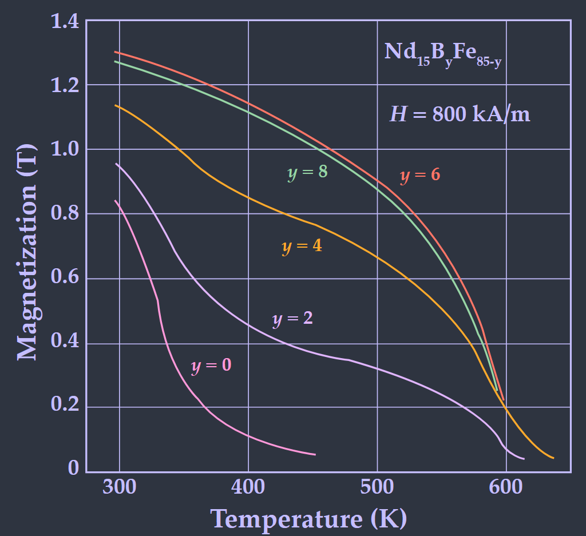

Là nhiệt độ mà ở đó vật chất mất đi từ tính bền (permanent magnetic properties), còn được coi là quá trình chuyển pha mà không thay đổi cấu trúc vật chất. 

Khi ở trên ngưỡng này thì <a class="wikilink wikilink--empty" href="#note-ferrimagnet-nam-cham-sat-tu" data-note="ferrimagnet-nam-cham-sat-tu">Ferrimagnet (Nam châm sắt từ)</a>, <a class="wikilink" href="#note-chat-sat-tu-ferromagnet" data-note="chat-sat-tu-ferromagnet">Chất sắt từ (Ferromagnet)</a> sẽ trở thành chất thuận từ <a class="wikilink" href="#note-chat-thuan-tu-paramagnet" data-note="chat-thuan-tu-paramagnet">Chất thuận từ (Paramagnet)</a>. 

### Lý giải cho hiện tượng mất từ tính do nhiệt độ

Khi nhiệt độ tăng lên, các moment sẽ dao động do chuyển động nhiệt, mà nhiệt độ càng tăng thì chuyển động nhiệt càng mạnh, nên ở một ngưỡng nào đó dao động do chuyển động nhiệt sẽ lấn át tương tác trao đổi giữa các moment từ với nhau (tương tác này ưu tiên cho các moment song song với nhau). 

Khi các moment từ mất định hướng, từ hoá tự phát sẽ tiến về 0 khi các moment không còn cùng hướng.

Mối quan hệ giữa <a class="wikilink" href="#note-magnetization-tu-do" data-note="magnetization-tu-do">Magnetization (Từ độ)</a> và nhiệt độ Curie $$T_c$$ là quá trình liên tục. Không phải tại $$T_c$$ thì từ độ đột ngột về 0, mà trong quá trình vật nóng lên, từ độ sẽ mất dần từ từ, đến $$T_c$$ thì chính thức về 0 hoặc rất sát 0. Có thể nói nhiệt độ là một trong các phương pháp dùng để khử từ nam châm. 

**Hình minh hoạ**: Mối quan hệ giữa từ độ và nhiệt độ của nam châm với nhiệt độ [New Material for Permanent Magnets on a Base of Nd and Fe - Sagawa et al.]

Nhiệt độ Curie $$T_c$$ phụ thuộc vào chất làm ra vật liệu, và cả tỷ lệ thành phần của các chất trong vật liệu đó. $$T_c$$ là một yếu tố quan trọng để đánh giá hiệu năng của nam châm, vì có những môi trường đặc biệt cần ứng dụng của nam châm và việc xác định được ngưỡng từ tính của vật tại mức nhiệt độ đó giúp ta hiểu được giới hạn của nam châm. 

Như đã đề cập phía trên, tuy nhiệt độ là một phương pháp khử từ, nhưng nhiệt độ Curie thường nhỏ hơn nhiệt độ làm vật biến dạng, nên thực tế vật chỉ bị mất từ tính. Nếu như muốn vật có từ tính, hay muốn từ hoá vật trở lại thì chỉ cần làm nguội vật và áp một từ trường ngoài vào vật lần nữa.
