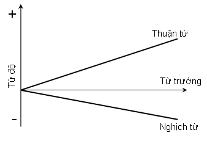

Là đồ thị mô tả quá trình từ hoá vật liệu từ trạng thái chưa nhiễm từ. 

Thông tin trên đồ thị chỉ ra sự thay đổi của tính chất từ (thông qua giá tị từ độ, cảm ứng từ, ...) theo giá trị của từ trường ngoài. 

Chất thuận từ <a class="wikilink" href="#note-chat-thuan-tu-paramagnet" data-note="chat-thuan-tu-paramagnet">Chất thuận từ (Paramagnet)</a> và chất nghịch từ <a class="wikilink" href="#note-chat-nghich-tu-diamagnet" data-note="chat-nghich-tu-diamagnet">Chất nghịch từ (Diamagnet)</a> có từ độ <a class="wikilink" href="#note-magnetization-tu-do" data-note="magnetization-tu-do">Magnetization (Từ độ)</a> tuyến tính với từ trường ngoài.
