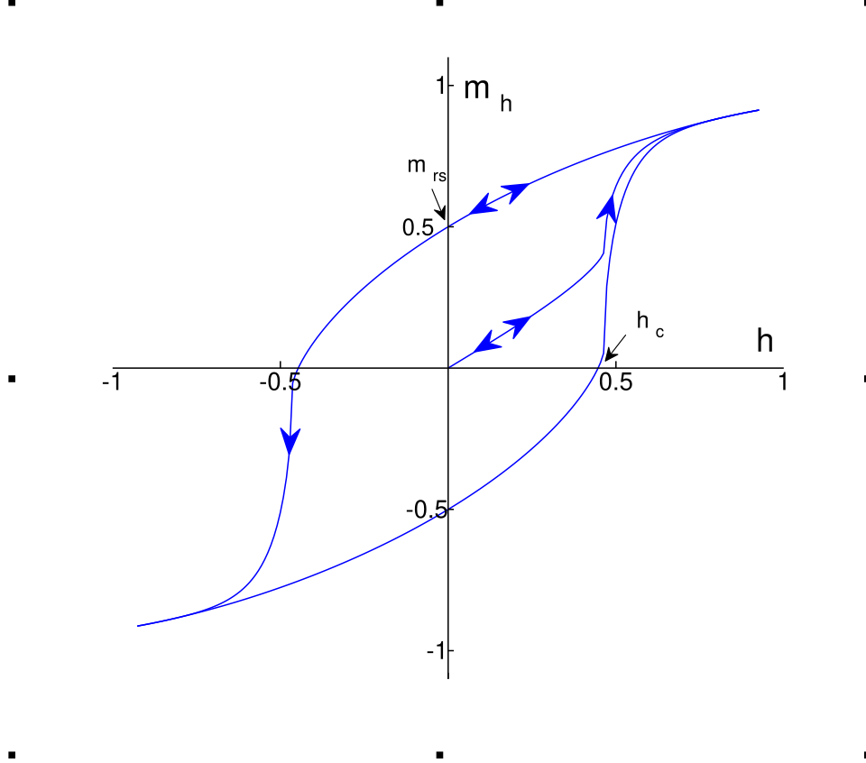

Hiện tượng này xảy ra khi một từ trường ngoài áp vào chất sắt từ <a class="wikilink" href="#note-chat-sat-tu-ferromagnet" data-note="chat-sat-tu-ferromagnet">Chất sắt từ (Ferromagnet)</a> ví dụ như sắt và các lưỡng cực nguyên tử align (bị xoay theo chiều từ trường). 

Khi từ trường ngoài biến mất, các lưỡng cực vẫn sẽ giữ nguyên chiều như cũ. Khi này ta nói rằng vật đã bị từ hoá, và trạng thái này sẽ tiếp tục cho đến khi bị tác động bởi nhiệt độ hoặc một từ trường ngoại khác ngược chiều từ trường ban đầu. 
 
Một vật (VD: thép) bị từ hoá thì sau khi tắt từ trường ngoài vẫn sẽ tồn tại từ trường trong lõi thép (Do momen từ $$M$$ <a class="wikilink" href="#note-magnetization-tu-do" data-note="magnetization-tu-do">Magnetization (Từ độ)</a> và trường khử từ $$H_d$$). Nếu bật lại từ trường ngược hướng với từ trường ban đầu gây ra từ hoá với cùng độ lớn, từ trường trong lõi thép sẽ bị triệt tiêu. Khi đó trường phía sau gọi là **trường khử từ**.

Từ trễ được thể hiện thông qua đường cong từ trễ (hình bên dưới). [Magnetic hysteresis - Wikipedia](https://en.wikipedia.org/wiki/Magnetic_hysteresis)

### Giải thích đồ thị:

Ở góc phần tư thứ I (đường xuất phát từ (0,0)). Khi tăng $$H$$ trong khoảng [0, 0.47] thì quá trình là gần tuyến tính và thuận nghịch, tức là $$H$$ tăng thì $$M$$ tăng và ngược lại. Nhưng khi $$H$$ vượt qua một ngưỡng nhất định (phụ thuộc vào vật liệu) thì $$M$$ tăng vọt (Chưa hiểu lý do cho hiện tượng này) và bắt đầu quá trình bất thuận nghịch, và từ điểm bắt đầu quá trình bất thuận nghịch này trở đi thì tương quan giữa $$M-H$$ sẽ đi theo vòng chính (loop) là đường kín bên ngoài trên đồ thị. 

Lưu ý $$M$$ ở đây đã được chuẩn hoá, khi quá trình tăng $$H$$ tiếp tục diễn ra thì sau giai đoạn nhảy vọt sẽ tiến đến quá trình bão hoà $$M_s$$. Điều này xảy ra khi phần lớn momen đã cùng hướng từ trường, vì vậy tăng từ trường $$H$$ cũng không khiến $$M$$ tăng thêm nhiều. 

Hiện tượng từ trễ xảy ra khi từ điểm bão hoà, ta giảm cường độ từ trường ngoài. Khi này $$H->0$$ nhưng $$M$$ không tiến về 0, mà sẽ đi sát về giá trị bão hoà $$M_{rs}$$ (giá trị bằng khoảng 50% giá trị bão hoà cực đại). Mũi tên ở quanh khu vực này chỉ ra rằng những thay đổi nhỏ của $$H$$ đáp ứng thuận nghịch ($$H$$ giảm $$M$$ giảm và ngược lại). Khi từ trường tắt hoàn toàn ($$H=0$$) thì lúc này $$M \neq 0$$ và ta gọi phần $$M_{rs}$$ này là **từ dư**. Từ dư được hiểu là từ tính còn được giữ lại của vật sau khi loại bỏ từ trường ngoài - nguyên nhân từ hoá vật chất. 

Ở góc phần tư thứ II, khi đảo ngược chiều từ trường ngoài so với ban đầu thì đến khi từ trường có cường độ $$H_c$$ thì sẽ khiến cho momen từ $$M$$ tiến về giá trị 0, khi này ta nói vật bị khử từ, và $$H_c$$ đại diện cho khả năng kháng từ của vật chất, tức là cần một từ trường có độ lớn bao nhiêu để xoá bỏ **từ dư** của một vật liệu. 

Quá trình này là quá trình đối xứng, ở góc phần tư thứ III và IV thì quá trình diễn ra tương tự, chỉ khác về mặt dấu do chiều từ trường đã bị đảo ngược.
