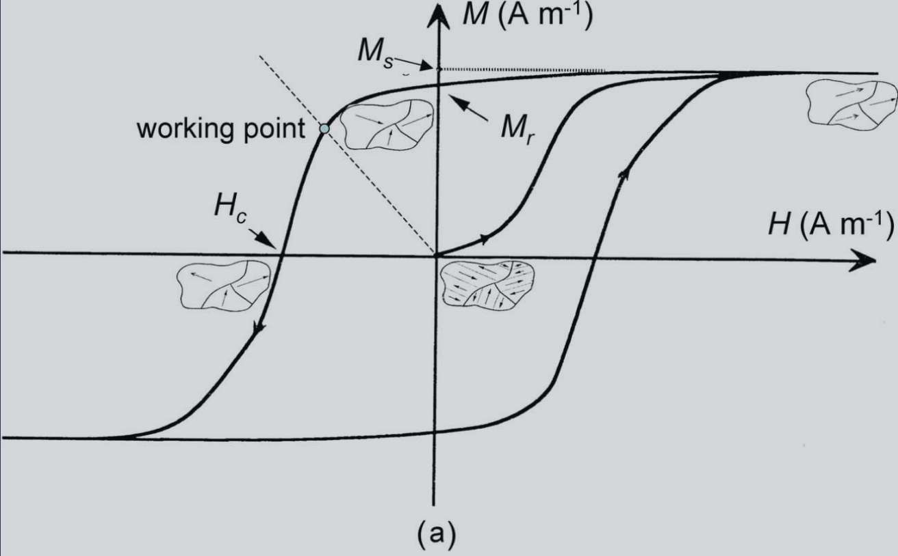
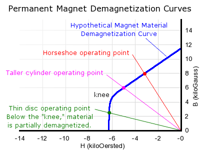
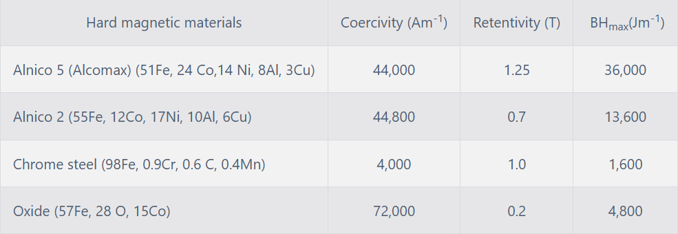
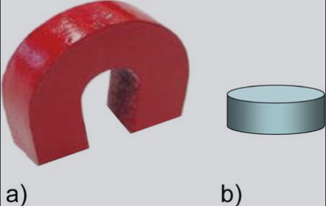

---
# Body below the front matter is generated by scripts/obsidian_graph.py.
# Edit the Obsidian note and re-run the script; front matter is kept.
layout: graph-post
title: "Hard Magnetic Materials - A perspective (J.M.D Coey)"
date: 2026-11-17
tag: technical
description: "Linh tinh"
read_time: 9
math: true
notegraph: magnetic
image: /assets/images/magnetic.jpg
---

Trước năm 1951, các nam châm giá rẻ được làm chủ yếu với các hình dạng như: kim la bàn, móng ngựa và thanh chữ nhật. 

Lý do tại sao nam châm được làm ở các hình dạng đó là do tồn tại một từ trường khử từ <a class="wikilink wikilink--empty" href="#note-tu-truong-khu-tu-demagnetinizing-field" data-note="tu-truong-khu-tu-demagnetinizing-field">Từ trường khử từ (Demagnetinizing field)</a> $$H_d$$ bên trong nam châm, với độ lớn phụ thuộc vào độ từ hoá <a class="wikilink" href="#note-magnetization-tu-do" data-note="magnetization-tu-do">Magnetization (Từ độ)</a> như sau:

$$
H_d = -N. M
$$

với **N** là hệ số khử từ, phụ thuộc vào kích thước và nằm trong khoảng [0,1]. $$H_d$$ và $$M$$ đều là vector. 

Đặc tính của nam châm sắt từ khi phản ứng với từ trường ngoài được thể hiện qua đường cong từ trễ <a class="wikilink" href="#note-magnetic-hysteresis-tu-tre" data-note="magnetic-hysteresis-tu-tre">Magnetic Hysteresis (Từ trễ)</a> $$M(H)$$ (hình 1.a).

$$H_c$$ ở đây thể hiện cho khả năng kháng từ của một chất, trong khi $$H_d$$ là từ trường khử từ tồn tại song song với moment từ $$M$$, quan hệ của cả hai được suy ra từ hai phương trình:

$$
\begin{gathered}
\mathbf{B} = \mu_0 (\mathbf{H} + \mathbf{M})
\\
\nabla \cdot \mathbf{B} = 0
\\
\Rightarrow \nabla \cdot \mathbf{H} = -\nabla \cdot \mathbf{M}
\end{gathered}
$$

Mục tiêu của $$H_d$$ là giảm năng lượng của hệ, khiến cho tích $$\vert BH\vert $$, đại diện cho mật độ năng lượng trên một đơn vị thể tích <a class="wikilink" href="#note-energy-stored-in-magnetic-field" data-note="energy-stored-in-magnetic-field">Energy stored in magnetic field</a>. Lý do là vì

$$
\begin{gathered}
\mathbf{B} = \mu_0 (\mathbf{H} + \mathbf{M}) 
\\
\mathbf{H} = -N.\mathbf{M}
\\
-> \vert BH\vert  = \mu_0(1-N).N.{M_s}^2
\end{gathered}
$$

Với $$M_s$$ là từ độ bão hoà. Có thể thấy chính bản thân hình dạng nam châm (thông qua hệ số N) ảnh hưởng đến chất lượng của nam châm. 

Quay trở lại hình 1.a, **working point** được định nghĩa là giao giữa đường $$M = -(1/N).H_d$$ với đường cong từ trễ. Ý nghĩa của nó nói rằng, nếu ở tại working point này mà $$M \leq 0$$ thì từ hoá sẽ tiến vào trạng thái đa domain <a class="wikilink" href="#note-magnetic-domain-domain-tu" data-note="magnetic-domain-domain-tu">Magnetic Domain (Domain từ)</a>. Khi có quá nhiều domain thì các momen từ ở các domain sẽ triệt tiêu lẫn nhau, khiến cho vật mất đi từ tính, hay nói cách khác vật liệu đã bị khử từ, không còn là nam châm vĩnh cửu. 

Điều kiện để một nam châm là nam châm vĩnh cửu, đó là khả năng kháng từ $$\vert H_c\vert $$ của nó phải lớn hơn từ trường khử từ bên trong vật chất $$\vert H_d\vert $$ (độ lớn). 

Trong đường cong từ trễ, $$H_c$$ là giao của $$M(H)$$ với trục hoành. Ta nói *hard magnet* (nam châm cứng) là nam châm làm từ vật liệu có $$\vert H_d\vert  \gt \vert H_d\vert $$ có hình dạng đẳng trục (equixial shape), còn *soft magnet* chỉ các vật liệu có $$\vert H_c\vert  << \vert H_d\vert $$. Các vật liệu nằm ở giữa hai loại này được coi là *semihard*, chủ yếu dùng cho đĩa từ. 

Vậy thì điều kiện để làm ra một nam châm vĩnh cửu ở trước năm 1951 phải phụ thuộc vào hai yếu tố:

1. Chất làm ra nam châm đó ($$H_c$$ và $$M_s$$)
2. Hình dạng của nam châm ($$N$$ - hệ số khử từ)

$$N = 1/3$$ cho hình cầu, $$N=0$$ cho long needle từ hoá theo trục của nó hoặc tấm film mỏng được từ hoá in-plane. $$N=1$$ cho film mỏng từ hoá vuông góc với mặt phẳng. Hình móng ngựa không có $$N$$ cụ thể, giá trị sẽ phụ thuộc vào hình dáng thực tế và phải tính qua thực nghiệm. 

Các hình dạng khác nhau sẽ cho working point khác nhau, thể hiện qua hình dưới (Nguồn: [Why are Magnets Shaped like Horseshoes? \| K&J Magnetics Blog](https://www.kjmagnetics.com/blog/why-horseshoe-shaped-magnets)). 

Bảng giá trị $$H_c$$ của một số vật liệu dùng cho nam châm vĩnh cửu (Nguồn: [Magnetism World - Magnetism World](https://magworld.physics.auth.gr/world/basics/9))

Trước năm 1951 thì vật liệu chủ yếu làm nam châm là **Alnico** và **thép**. Thông tin về $$M_s$$ tương ứng của hai chất này được Coey đề cập ở trang 4 của bài báo. Một lưu ý nhỏ là $$M_s$$ của thép được lấy theo $$M_s$$ của sắt, mặc dù việc pha sắt cùng các chất khác tạo thành hợp kim sẽ có thể thay đổi $$M_s$$ và sẽ phải đo lại giá trị tương ứng, nhưng ở đây mình lấy theo giá trị của sắt để có góc nhìn tham khảo.  

Tính hệ số $$H_d / M_s$$ tương ứng cho từng vật liệu ta có: 

- Thép: $$4000 / (1,72.10^6) = 0.002$$ 
- Alnico: $$44800/(1,1.10^6) = 0.041$$

Cả hai giá trị này cho thấy nếu sử dụng hai chất này làm nam châm thì phải làm thành hình kim, nếu không thì chúng sẽ có xu hướng tiến về trạng thái khử từ. 

Vậy thì bước ngoặt sẽ xảy đến nếu chúng ta tìm được một vật liệu mà có $$H_c$$ >> $$M_s$$, để cho làm thành hình dạng gì thì vẫn sẽ được coi là nam châm vĩnh cửu. Vào năm 1951, một họ vật liệu mới, ferrimagnetic hexagonal ferrites đã được phát hiện. Chúng có khả năng kháng từ $$H_c$$ lớn hơn rất nhiều so với từ độ tự phát $$M_s$$, khiến cho việc biến chúng trở thành nam châm vĩnh cửu đơn giản hơn rất nhiều, vì khi này không còn ràng buộc về hình dạng. 

## Mật độ năng lượng từ 

Phần trước là điều kiện cần để làm ra được nam châm vĩnh cửu, tuy nhiên trong thực tế cũng phân biệt nam châm vĩnh cửu tốt thông qua mật độ năng lượng từ $$\vert BH\vert $$, đơn vị là $$J/m^3$$ 

Từ trường ngoài (stray field) do một nam châm gây ra tại một điểm cách nó một khoảng $$r$$, ký hiệu $$H(r)$$ có quan hệ đến từ hoá tự phát của nam châm $$M$$ thông qua biểu thức $$H(r) = K(r).M$$, vì thế nên mật độ năng lượng $$\vert BH\vert $$ vốn dĩ tỷ lệ với $$H^2$$ (vì $$B = \mu_0 H$$ ở phía ngoài nam châm) nên $$\vert BH\vert  ∝ M^2$$. Lý do ta xét từ trường phía ngoài vì đây mới là trường cần sử dụng để ứng dụng vào thực tế. 

Giá trị $$\vert BH\vert $$ cao thì thể hiện rằng với cùng một lượng từ thông, thì thể tích nam châm cần sử dụng cũng nhỏ đi, nam châm cần chế tạo cũng có thể nhỏ gọn hơn. 

Ở phía trên, ta đã tính được rằng:

$$
\vert BH\vert  = \mu_0(1-N).N.{M_s}^2
$$

Lấy đạo hàm theo $$N$$, ta có giá trị cực đại $$\vert BH\vert _{max}$$ đạt được khi $$N=1/2$$ và khi đó $$\vert BH\vert _{max} = 1/4 \mu_0M^2_s$$. Khi này điều kiện để có nam châm vĩnh cửu là vật liệu làm ra nó phải có $$H_c \gt M_s/2$$. 

> Các hình trụ có chiều cao bằng với bán kính cho ra $$N$$ rất sát $$1/2$$. Hình minh hoạ đính kèm phía dưới. 

a) Hình dạng tối ưu cho nam châm vĩnh cửu trước năm 1951.

b) Hình dạng tối ưu cho nam châm vĩnh cửu sau năm 1951.

Sau khi đã tìm ra được hình dạng tối ưu cho nam châm, chúng ta lại gặp phải một vấn đề khác. Trên thực tế rất nhiều ứng dụng của nam châm cần đến độ lớn bậc 2 của mật độ từ thông $$B = \mu_0 H$$, vì từ thông $$\Phi_B$$ có dạng:  

$$
\Phi_B = \iint_S \mathbf{B} \cdot d\mathbf{S}
$$

Mà $$H ∝ M$$, nên nói cách khác mật độ từ thông phụ thuộc vào độ từ hoá của nam châm đó, và độ từ hoá tự phát cực đại lại liên quan đến chất liệu làm ra nam châm. 

## Trường dị hướng (Anisotropy Field)

Một vài định nghĩa cần làm rõ trước khi đi vào chủ đề chính:

- Easy axis: là hướng trong vật liệu từ mà từ độ **M** thích nằm theo nhất, vì năng lượng dị hướng ở đó thấp nhất. Nói là trục vì moment từ có thể xuôi hoặc ngược chiều trục. 
- Năng lượng trường dị hướng $$E_a$$, được khai triển với leading term là $$E_a =K_1.\sin^2(\theta)$$ với $$K_1$$ là hằng số dị hướng và $$K_1 >0$$, và $$\theta$$ là góc giữa từ độ **M** và easy axis. Có thể thấy $$E_a$$ cực tiểu khi $$\theta = 0$$ hoặc $$\theta = \pi$$ và cực đại khi $$\theta = \pi/2$$ và $$E_a=K_1$$ khi đó. $$E_a$$ ở đây có đơn vị là $$kJ/m^3$$, là mật độ năng lượng trên mỗi $$m^3$$ vật liệu. $$E_a$$ là năng lượng/thể tích yêu cầu để bẻ **M** từ easy axis ra hướng khó nhất (vuông góc với easy axis). $$K_1$$ vì thế là rào năng lượng để quay **M** một góc 90 độ, vì thế $$K_1$$ càng cao thì ta nói rằng khả năng kháng từ của vật càng mạnh. 
- Magnetic hardness parameter: ký hiệu là $$κ$$, xác định thông qua biểu thức $$\kappa = \sqrt{\frac{K_1}{\mu_0 M_S^2}}$$ 

Như đã phân tích về tham số $$N$$, yêu cầu để vật không tự khử từ là $$H_c > M_s/2$$. Đây là yêu cầu tối thiểu cho nam châm vĩnh cửu tối ưu với $$N=1/2$$. Giới hạn vật lý của kháng từ tính là trường dị hướng $$H_a$$, biểu diễn bởi:

$$
H_a = 2K_1/M_s
$$

Đây là trường làm mất độ bền của trạng thái. Theo lý thuyết (nói vắn tắt của việc mình không chứng minh được) thì $$H_c \leq H_a$$, nên ta có:

$$
2 \kappa^2.M_s > M_s/2  -> \kappa > 1/2
$$

(Vì với $$N=1/2$$ thì $$H_c>M_s/2$$ và $$H_a \geq H_c$$ nên $$H_a \gt M_s/2$$ )

Tuy nhiên thực tế thì cần $$\kappa > 1$$ và $$K_1$$ cũng cần lớn hơn 4 lần so với ước tính của mô hình Stoner-Wohlfarth. 

$$\kappa$$ thể hiện cho mức độ kháng từ (vì $$\kappa$$ lớn thì có thể $$K_1$$ cũng lớn) nhưng không phải yếu tố đánh giá, vì có thể $$\kappa$$ lớn đơn giản là vì tỷ số $$K_1/M_s$$ lớn, mà một trong các tình huống xảy ra là $$M_s$$ nhỏ. Khi này vật liệu kháng từ tốt, nhưng $$M_s$$ nhỏ thì ứng dụng của nam châm, thể hiện qua trường rò ra ngoài cũng nhỏ theo. Vì vậy $$\kappa$$ sẽ phải đi kèm với các tiêu chí khác để đánh giá chất lượng của nam châm. 
## Nhiệt độ Curie
Ngoài các yếu tố kể trên, một trong những yếu tố quan trọng xác định khả năng ứng dụng của nam châm là <a class="wikilink" href="#note-curie-temperature-nhiet-do-curie" data-note="curie-temperature-nhiet-do-curie">Curie Temperature (Nhiệt độ Curie)</a>. 

## Vật liệu làm nam châm vĩnh cửu

Alnico: mặc dù có $$\kappa < 1$$, **Alnico** có $$M_s$$ lớn (lên tới $$1.1 MA .m^{-1}$$) và nhiệt độ Curie cao (> 1200K) và energy product lớn (lên tới 70kJ $$m^{-3}$$).

$$SmCo_5$$: intermetallic với $$K_1 = 17.2 MJ.m^{-3}$$ và $$M_s = 860 kA.m^{-1}$$ lớn hơn ferrite rất nhiều. Nam châm làm từ hợp chất này không cần phải quan tâm đến hình dạng vì $$H_c > M_s/2$$ và $$\kappa = 4.3$$. Energy product đạt được lên tới $$190kJ.m^{-3}$$ .

$$Sm_{2}Co_{17}$$: nhóm nam châm làm từ hợp chất này theo tỷ lệ 2:17, ký hiệu là $$Sm(Co, Fe, Cu, Zr)_{7-8}$$ có $$K_1 = 4.2MJ.m^{-3}$$ và $$M_s = 0.97 MA.m^{-1}$$, $$\kappa = 1.9$$ và energy product lên tới $$260 kJ.m^{-3}$$ .

Mặc dù có hiệu suất tốt, nam châm Sm-Co bị hạn chế sản xuất rộng rãi do giá cả của nó, đến từ việc Cobalt không có nhiều ngoài tự nhiên và nguồn cung ở Zaire bị ảnh hưởng bởi tình hình chính trị ở central Africa. 

Sắt (Fe) là một chất có rất nhiều trong tự nhiên, với $$M_s$$ = 1.72 MA . $$m^{-1}$$. Nếu có thể tìm được một hợp chất mà trong đó sắt là một thành phần thì sẽ là một bước tiến mới cho lĩnh vực. 

$$Nd_{2}Fe_{14}B$$: có từ hoá $$M_s$$ = 1.28 MA . $$m^{-1}$$ và $$\kappa = 1.54$$, và các nỗ lực tối ưu đã khiến cho energy product lên tới 474 kJ.$$m^{-3}$$ trong điều kiện phòng thí nghiệm. Mặc dù hợp chất này là lý tưởng cho các ứng dụng liên quan (spindle motor, voice coil actuators, ...) nhưng hợp chất này có hai điểm yếu:
1. Nhiệt độ Curie thấp (cỡ 588K)
2. giá trị $$\kappa$$ nhỏ, khoảng 1.54
Vì vậy hợp chất này không đạt hiệu năng cao ở nhiệt độ cao. 

## Các nguồn đọc thêm:

- Cách tính $$N$$ cho hình dạng bất kỳ: [Effective Demagnetizing Factors of Diamagnetic Samples of Various Shapes \| Phys. Rev. Applied](https://journals.aps.org/prapplied/abstract/10.1103/PhysRevApplied.10.014030), bản free: [[1712.06037] Effective Demagnetization Factors of Diamagnetic Samples of Various Shapes](https://arxiv.org/abs/1712.06037). 
- Tại sao nam châm lại có hình móng ngựa: [Why are Magnets Shaped like Horseshoes? \| K&J Magnetics Blog](https://www.kjmagnetics.com/blog/why-horseshoe-shaped-magnets)
